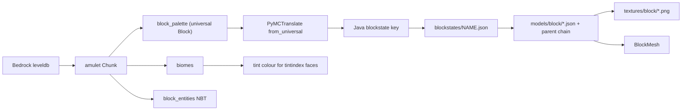

# Block model format, and what the renderer can rely on

Written after auditing a real Bedrock save (`world/`, last opened with Bedrock
`1.26.44.3`) against the vanilla Java resource pack for `26.2`. Every number
here was measured by the scripts in `probes/`; re-run them to refresh it.

## The conclusion first

No block variants need hardcoding. Minecraft's own renderer is driven by two
layers of JSON, and a Bedrock save can be fed into that same data.

Measured over 81 chunks (3.1 million blocks) around the build at block
`(300, 70)`:

| Question | Answer |
| --- | --- |
| Distinct blockstates in the region | 653 (652 excluding air) |
| Distinct base names | 183 |
| Base names whose properties fall inside the declared schema | 183 of 183 |
| Blockstates that translate to a Java blockstate | 650 of 652 (99.69%) |
| Blockstates that resolve to real geometry | 583 of 652 (89.42%) |
| Gaps the resource pack could have filled but we missed | 0 |

The last row is the important one. Every gap is a block that Minecraft itself
does not render from block model JSON, so the abstraction holds completely for
the blocks it is meant to cover.

## The pipeline



The translation stage is not optional. `get_block_model` is documented as
requiring a block that is "already in the resource pack format", and amulet
hands us universal blocks like
`universal_minecraft:trapdoor[material=birch,...]`. PyMCTranslate turns that
into `minecraft:birch_trapdoor[facing=west,half=bottom,open=true,powered=false]`,
which is exactly the key format used inside
`assets/minecraft/blockstates/birch_trapdoor.json`.

Note what happens to `material`: it moves from a property into the block name.
One universal `trapdoor` with a 21-value `material` property becomes 21 Java
block names, which is why the universal schema stays small while the Java
namespace is large.

## Layer 1: blockstates JSON

`assets/minecraft/blockstates/<name>.json` maps property combinations to models.
There are two forms, and the pack uses 1096 of the first and 102 of the second.

### `variants`: exact property-string lookup

Keys are the property assignments, comma separated and sorted by property name.
An empty key `""` matches any state.

```json
{
  "variants": {
    "facing=east,half=bottom,open=false": {
      "model": "minecraft:block/birch_trapdoor_bottom",
      "y": 90
    }
  }
}
```

`x` and `y` rotate the model in 90 degree steps. A variant value can also be a
list of weighted alternatives, which is how the game randomises things like
grass and stone; a renderer can pick the first entry or hash the coordinates.

Only properties that affect appearance appear in the key. `birch_trapdoor` has a
`powered` property but the blockstate file never mentions it, so a lookup must
tolerate extra properties rather than requiring an exact match.

### `multipart`: conditional geometry, additively combined

```json
{
  "multipart": [
    { "apply": { "model": "minecraft:block/cobblestone_wall_post" },
      "when": { "up": "true" } },
    { "apply": { "model": "minecraft:block/cobblestone_wall_side", "uvlock": true, "y": 90 },
      "when": { "east": "low" } }
  ]
}
```

Every case whose `when` matches contributes its model, and the results are
merged. `when` supports a flat property match, `OR` with a list of matches, and
`AND`. A value may be pipe-separated (`"low|tall"`) to match several values.

This is the whole answer to fences, walls, panes, vines and redstone wire.
Connection geometry is data: the save stores `north`/`east`/`south`/`west`
properties, and multipart assembles the shape. Nothing needs to know that a wall
is a wall. `uvlock` keeps the texture axis-aligned while the model rotates.

## Layer 2: model JSON

`assets/minecraft/models/block/<name>.json`. This is where the real leverage is:
of 2657 block models, only **343 define geometry at all**. The other 2314 are
pure data that inherit a shape and swap textures.

`oak_slab.json` in full:

```json
{
  "parent": "minecraft:block/slab",
  "textures": {
    "bottom": "minecraft:block/oak_planks",
    "side": "minecraft:block/oak_planks",
    "top": "minecraft:block/oak_planks"
  }
}
```

All 64 slab models look like that. The geometry lives once, in `block/slab`:

```json
{ "parent": "block/block",
  "textures": { "particle": "#side" },
  "elements": [
    { "from": [ 0, 0, 0 ], "to": [ 16, 8, 16 ],
      "faces": {
        "down":  { "uv": [ 0, 0, 16, 16 ], "texture": "#bottom", "cullface": "down" },
        "up":    { "uv": [ 0, 0, 16, 16 ], "texture": "#top" },
        "north": { "uv": [ 0, 8, 16, 16 ], "texture": "#side", "cullface": "north" }
      }
    }
  ]
}
```

The pieces a renderer has to implement:

- **`parent`** is an inheritance chain to follow until a model defines
  `elements`. Resolve child-first: a child's `textures` and `elements` override
  the parent's.
- **`textures`** is a variable table. A value starting with `#` is a reference to
  another entry, resolved against the merged table, so `#side` in the parent
  resolves to `oak_planks` supplied by the child. References can chain, so
  resolve iteratively and guard against cycles.
- **`elements`** are axis-aligned cuboids in a 0-16 block-local space. Values
  outside 0-16 are legal and used for things like fence posts. An element may
  carry a `rotation` (an axis, an origin and one of -45/-22.5/0/22.5/45) which is
  how crossed plants and dripleaves are shaped.
- **`faces`** are keyed by direction. Each has a `texture` reference, an optional
  `uv` (defaults to the element's own extent), an optional `rotation` in 90
  degree steps, an optional `cullface`, and an optional `tintindex`.
- **`cullface`** names the neighbour direction that hides this face. This is the
  data behind face culling, and the model reader already groups mesh data by it:
  `BlockMesh.verts` and `.faces` are dicts keyed by cull direction, with `None`
  for faces that are always drawn. The birch trapdoor spike returned
  `(None, 'down', 'east', 'north', 'south', 'up')`, missing `west` because an
  open trapdoor sits flush against its western neighbour.
- **`tintindex`** means the face colour is multiplied by a runtime tint. Only 33
  block models use it.

## Assets: where to get them, what to be careful about

The vanilla pack is fetched at runtime, not vendored:
`minecraft_model_reader.api.resource_pack.java.download_resources`. It reads
Mojang's public launcher manifest, picks the latest release (`26.2` at the time
of writing, which happens to match PyMCTranslate's newest Java definitions), and
extracts `assets/` from the client jar into a per-user cache
(`~/Library/Caches/AmuletTeam/resource_packs/java/vanilla`, 45 MB, 1198
blockstates, 2657 block models, 1371 block textures). It took about three
seconds here.

Two practical notes:

- Downloading into a user cache at runtime is also the right answer legally.
  Minecraft's assets are copyrighted and the EULA does not grant redistribution
  rights, so extracted textures and JSON must never be committed to this repo or
  shipped in a build. Every user's machine fetches its own copy from Mojang.
- The downloader has a history of `BadZipFile` failures on flaky connections
  (Amulet issue #994). It worked first try here, but the fallback is to point
  `JavaResourcePack` at a manually extracted `assets/` directory.

A second pack ships inside the library, `java_vanilla_fix`, and is stacked
underneath vanilla. It supplies water and lava textures that the extracted pack
lacks. Later packs override earlier ones, which `mcread/pack_inspect.py` mirrors
when it reads pack JSON directly.

## Where the data-driven abstraction ends

These are Minecraft's own exceptions, not gaps in our approach. The
`special_cases` probe classifies them by asking the pack whether it ships any
elements for the block, and reports zero cases where the pack had geometry we
failed to use.

**Fluids (38 blockstates, 50,564 blocks here).** `models/block/water.json`
contains only a particle texture and no elements. Water and lava surface height
comes from the `level` property and neighbouring fluid levels, computed by the
engine. Needs a custom fluid mesher; the `level` and `falling` properties are in
the save and translate correctly, so the input data is there.

**Block entities drawn with entity models (29 blockstates, 170 blocks here).**
Chests, ender chests, shulker boxes, banners, wall banners and decorated pots.
`models/block/chest.json` is also just a particle texture. Their real geometry
and textures live under `models/entity/` and `textures/entity/chest/`, drawn by a
block entity renderer. The NBT is available: the audit found 348 block entities
across 27 types, including banner `Patterns`, sign `front_text`/`back_text` with
the actual string, and chest `Items`.

**Blocks with no Java equivalent (2 blockstates).** Bedrock's
`item_frame_block` translates to `minecraft:air`, because Java models item frames
as an entity rather than a block. The item frame data is still reachable as a
block entity with `Item` and `ItemRotation`.

**Runtime tint (28 blockstates, 14,554 blocks here).** Geometry resolves fine,
but `tintindex` faces need a colour from somewhere: the biome for grass, leaves,
ferns and vines; power level for redstone wire; water colour for cauldrons. The
save provides biomes at 4x4x4 resolution per sub-chunk with their own palette,
and 5 distinct biomes appear in this region.

**Blockstates that depend on neighbours (44 blockstates).** `from_universal`
returns a third value flagging when the output is only fully defined given
surrounding blocks, and it is set for chests, beds, signs, shelves, campfires and
similar. `from_universal` accepts a `get_block_callback` for exactly this, so the
fix is wiring neighbour lookups rather than special-casing blocks.

## Risks worth re-checking

- **Version skew.** The save was written by Bedrock `1.26.44.3`; PyMCTranslate
  1.2.47's newest Bedrock definitions stop at `26.30`. It caused no damage in
  this region (zero failures), but it is the same class of problem that already
  required patching amulet to accept chunk version 42.
- **Silent passthrough.** `from_universal` does not raise on an unknown block. It
  logs a warning and returns the input unchanged, still in the
  `universal_minecraft` namespace, which would then quietly miss in the resource
  pack. `TranslationResult.passed_through` checks the output namespace for this;
  it is currently zero, and the translation probe reports it as its own bucket so
  a future Bedrock update cannot hide there.
- **Region scope.** Every number above covers a 9x9 chunk region, not the whole
  world. Re-run with a larger `--radius` before treating them as world-wide.
